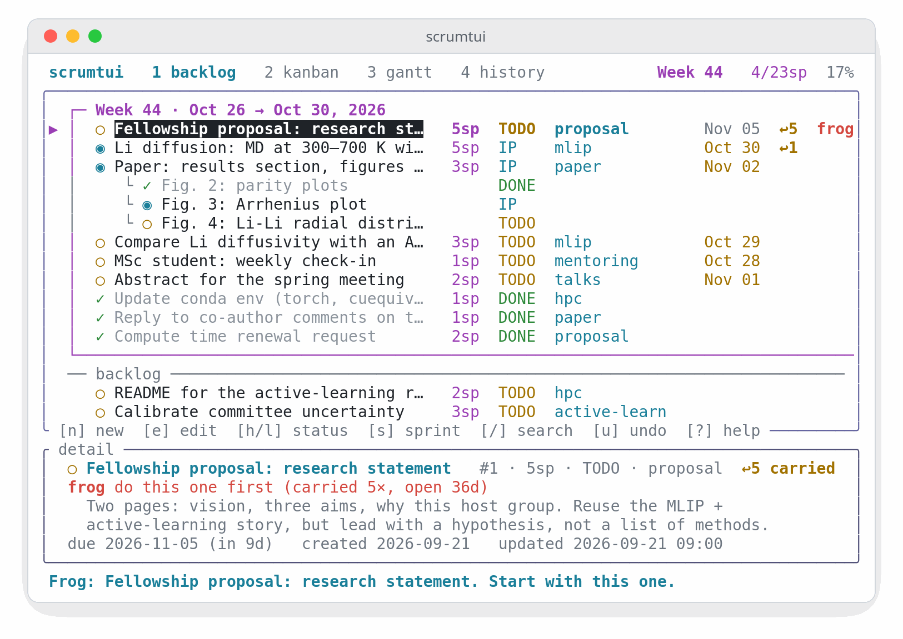
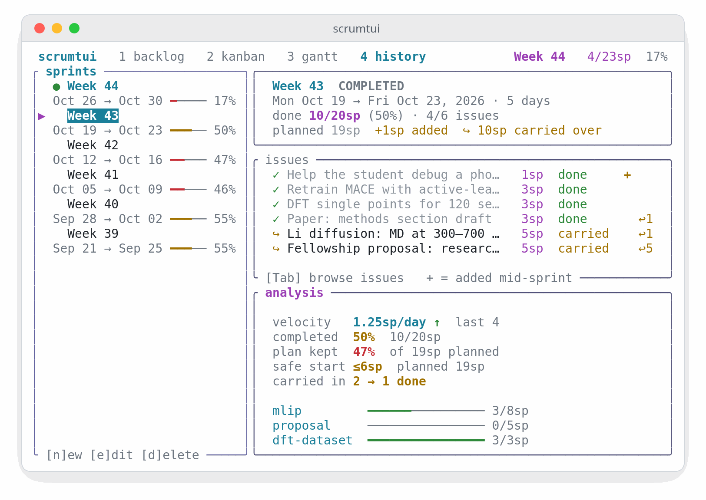

# scrumtui

A minimal, local, terminal-based scrum system driven by keyboard shortcuts. I use scrum every day to manage my research, and after years of imperfect solutions I vibe-coded this TUI to fit my needs. Maybe you'll find it useful too!

---

> **⚠ AI-GENERATED CODE DISCLAIMER**
>
> The majority of this codebase was generated with the assistance of OpenCode and Claude. It has been reviewed and lightly edited by a human, but has not been rigorously audited. Use at your own risk, and inspect any code before relying on it in a critical context.

---



## What it is

`scrumtui` is a lightweight personal scrum system that lives entirely on your machine. Everything is stored in a single SQLite file. Four views: **Backlog** (`1`), **Kanban** (`2`), **Gantt** (`3`), **Sprint History** (`4`).

---

## Building

Requires [Rust](https://rustup.rs/) (stable, 1.88+). SQLite is bundled at compile time.

```bash
git clone https://github.com/katnykiel/scrumtui
cd scrumtui
cargo build --release
./target/release/scrumtui demo    # Try it on a throwaway database with sample postdoc data
# or: ./target/release/scrumtui    # Start with your database (creates one if needed)
```

`demo` deletes its database when you quit. To keep a demo database around, seed a file and open it:

```bash
scrumtui --db ~/scrumtui-demo.db init --demo
scrumtui --db ~/scrumtui-demo.db
```

---

## Keys

Generally, I tried to use vim keybinds. If you've used vim before, this should feel comfortable. A key does the same thing in every view, and `?` lists them all.

| Key | Action |
|---|---|
| `j` / `k` (`↓` / `↑`) | move |
| `g` / `G` (`Home` / `End`) | top / bottom (as in `less`; vim's `gg` works too) |
| `PgDn` / `PgUp` | page |
| `h` / `l` (`←` / `→`) | status back / forward (kanban: column) |
| `Tab` | next panel / field |
| `n` | new |
| `e` / `Enter` | edit / open |
| `d` | delete |
| `/`, `Esc` | search, clear / back |
| `f` | pin / unpin the frog |
| `y` | copy issue to clipboard |
| `u` | undo |
| `S` / `T` | sprint manager / trash |
| `1`–`4` | switch view |
| `?` / `q` | help / quit |

Only in one place:

- **Backlog:** `s` into / out of the sprint · `Ctrl-J`/`Ctrl-K` reorder · `c` show / hide done
- **Kanban:** `Ctrl-H`/`Ctrl-L` move a card. `n` creates the card in the focused column; in the subtask panel it adds a subtask.
- **Forms:** `Enter` or `Ctrl-S` save · `Esc` cancel (twice if you changed something) · `Ctrl-N` add a subtask, `x` remove one · `Del` clear the due date
- **Sprint manager:** `Ctrl-N` switches between starting a new sprint and editing the current one
- **Trash:** `r` restore · `D` delete forever

Ctrl-arrows work like `Ctrl-h`/`j`/`k`/`l`.

---

## Sprints

A sprint runs Monday to Friday by default. `S` edits the current sprint; once it has ended, `S` sets up the next one instead. Saving the new sprint makes it active and carries every unfinished issue over, marked `↩N` (carried N times). In the sprint, unfinished issues come first, longest-standing on top.

## The frog

From "eat the frog": do the thing you've been avoiding first. Each day scrumtui picks one frog, the sprint's unstarted issue you've put off the longest (most carry-overs, then oldest, then biggest), marks it `frog` and names it when you open scrumtui. It stays your frog for the day whether you start it, finish it or leave it. An unfinished frog carries over to the next day; a finished one is replaced the next morning. `f` makes another issue today's frog, and `f` on the frog means no frog today.

## Sprint history



For each sprint: what was planned on its first day, what was added (`+`) or removed later, what got done, and what was carried over. The analysis panel shows:

- **velocity**: story points per day over the last five sprints, with a trend arrow
- **completed**: share of the final scope that got done
- **plan kept**: share of the first-day plan that got done
- **safe start**: how much to plan so that you'd usually finish it (25th percentile of past velocity)
- **carried in**: issues carried into this sprint, and how many of them got done
- **by epic**: where the points went

`Tab` moves into the issue list; `e` opens an issue.

---

## Database path

Resolved in order: `--db <path>` flag → `SCRUMTUI_DB` env var → `~/.config/scrumtui/config` (`db_path = ...`) → `~/.scrumtui.db`.

---

## CLI

```bash
scrumtui demo                          # Throwaway database with sample postdoc data
scrumtui init [--demo]                 # Initialize a database (optionally with sample data)
scrumtui add "Title" -e epic -p 2 -d 2026-11-20 -m "description" --sprint
scrumtui add "First step" --parent 42  # Subtask of #42
scrumtui edit 42 -t "New title" -d none --backlog
scrumtui show 42                       # Every field, the description and subtasks
scrumtui status 42 done
scrumtui list [--all] [--sprint] [-s todo|ip|done] [-e epic]
scrumtui import export.csv
scrumtui export [output.md]
```

Due dates take `YYYY-MM-DD`, `today`, `tomorrow` or `none`. Bad input is an error rather than a silent default, so a script (or an AI assistant adding issues for you) finds out when something went wrong. A running TUI picks up changes made from the command line within a second.

---

## Issue fields

Title, epic, story points, status, due date (`YYYY-MM-DD`), description, subtasks. Epic and due date autocomplete from existing values (the due date also offers today, tomorrow, the end of the sprint and next Monday). Subtask statuses roll up to the parent automatically. An **actual time** field tracks how long an issue was in progress (from first move to In Progress through completion), shown in the detail panel of both Backlog and Kanban views.

---

## Jira import

Handles Jira's default CSV export. Stories/Tasks/Bugs become top-level issues; Subtasks are linked to their parent. Run `scrumtui import export.csv`.

---

## Limitations

- One active sprint at a time
- Terminal should be at least ~90 columns wide
